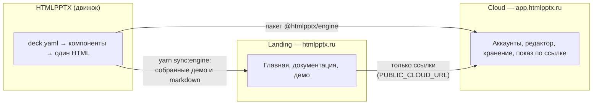

# Лендинг, облако и движок: как разграничить

Коротко: **три отдельные части на трёх адресах**. Лендинг ничего не знает о пользователях и только ссылается на облако. Облако не содержит маркетинга. Общее у них — движок HTMLPPTX и дизайн-токены.



## Кто за что отвечает

| | Лендинг (`Landing`) | Облако (`Cloud`, будет) | Движок (`HTMLPPTX`) |
|---|---|---|---|
| Адрес | `htmlpptx.ru` | `app.htmlpptx.ru` | — (пакет и CLI) |
| Задача | Рассказать, показать, научить | Работать с презентациями | Превращать YAML в презентацию |
| Стек | Astro 7, статика | любой с сервером (Next.js, Node API, Go…) | Vite + TypeScript |
| Данные | нет | пользователи, презентации, файлы | нет |
| Авторизация | нет | есть | нет |
| Секреты | нет | БД, хранилище, OAuth | нет |
| Деплой | статика на CDN или nginx | контейнер (k3s), БД, хранилище | npm-пакет / git-тег |
| SEO | индексируется | `noindex`, корень ведёт на `/login` или `/decks` | — |
| Темп релизов | правки текста — когда угодно | по готовности фич | по версиям |

## Правила границы

1. **Лендинг не ходит в облако за данными.** Никаких API-вызовов, сессий и cookies. Связь одна — ссылки, адрес из `PUBLIC_CLOUD_URL`. Вся логика ссылок собрана в одном компоненте: [`src/entities/cloud/CloudLink.astro`](../src/entities/cloud/CloudLink.astro).
2. **Пока облака нет, ссылки ведут на раздел `/#cloud`** с пометкой «скоро». Когда облако запустится, достаточно задать переменную и пересобрать сайт:
   ```bash
   PUBLIC_CLOUD_URL=https://app.htmlpptx.ru yarn build
   ```
3. **Облако не повторяет лендинг.** На `app.` нет страниц «о продукте». Неавторизованного пользователя облако отправляет на свою страницу входа, а ссылку «Что это?» ведёт на лендинг.
4. **Движок — единственный общий код.** Лендинг берёт у него только результаты (`public/demo/*.html`, `content/docs/*.md`), облако — сам код как пакет.
5. **Дизайн-токены общие по именам.** `--bg`, `--surf`, `--tx`, `--ac`… одинаковые в движке, лендинге и будущем облаке. Поэтому демо на лендинге выглядит частью страницы. Когда появится облако, токены стоит вынести в пакет `@htmlpptx/tokens`.

## Какие ссылки ведут из лендинга в облако

| Где | Куда | Сейчас |
|---|---|---|
| Кнопка «Облако» в шапке | `${CLOUD_URL}/` | `/#cloud` |
| «Открыть облако» на первом экране | `${CLOUD_URL}/` | `/#cloud` |
| Раздел «Облако» | `${CLOUD_URL}/` | `/#cloud` |
| Позже: «Открыть этот пример в облаке» | `${CLOUD_URL}/new?template=tour` | — |
| Позже: «Войти» | `${CLOUD_URL}/login` | — |

Новая ссылка добавляется так: `<CloudLink path="/new?template=tour" label="Открыть в облаке" />`.

## Почему не одно приложение

Можно было бы сделать один Next.js с группами маршрутов `(marketing)` и `(app)`. Это проще только в первый месяц. Дальше:

- **Безопасность.** У лендинга нет секретов и базы, взламывать в нём нечего. В общем приложении любая ошибка в маркетинговой странице живёт рядом с сессиями пользователей.
- **Скорость.** Лендинг — готовые HTML-файлы с CDN, на страницу уходит около 2 КБ JS (gzip). Приложению с авторизацией нужен сервер, и оно тянет за собой свой бандл.
- **Независимые релизы.** Поправить текст на главной не значит пересобирать и перезапускать облако. Упавшее облако не роняет сайт и документацию.
- **Разные требования к SEO и кешированию.** Лендинг индексируется и кешируется целиком. Облако персональное и не индексируется.

Если позже захочется держать всё в одном репозитории, это решается монорепо (`apps/landing`, `apps/cloud`, `packages/engine`, `packages/tokens` на yarn/pnpm workspaces). Деплои при этом всё равно остаются раздельными.

## Что понадобится от движка для облака

Сейчас каждую презентацию собирает Vite (`yarn build имя`). Для облака это дорого: сборка на каждое сохранение. Предлагаемый путь:

1. **Публичный API рендера**: `renderDeck(deck: Deck, container: HTMLElement)`. Облако показывает и редактирует презентацию прямо в браузере, без сборки.
2. **Экспорт без Vite**: движок собирается один раз в `runtime.js + runtime.css`. Экспорт файла = HTML-шаблон + встроенный runtime + JSON презентации + картинки в base64. Это делается за миллисекунды на сервере или прямо в браузере.
3. **Схема deck.yaml** (JSON Schema из `src/types.ts` и компонентов): по ней облако строит панель свойств и проверяет данные до сохранения.
4. **Протокол окон** (`src/engine/sync.ts`) уже подходит для связи редактора и предпросмотра. Лендинг использует его для управления демо: [`src/entities/deck/lib/protocol.ts`](../src/entities/deck/lib/protocol.ts).

## Порядок запуска облака

1. Создать репозиторий `Cloud` (или монорепо) и выбрать стек приложения.
2. В движке сделать пункты 1–3 из списка выше и опубликовать пакет.
3. Поднять `app.<домен>` с авторизацией и хранилищем.
4. В лендинге задать `PUBLIC_CLOUD_URL` и пересобрать: кнопки «скоро» станут ссылками на облако.
