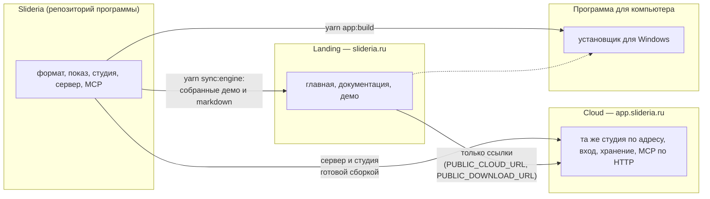

# Сайт, облако и программа: как разграничить

Коротко: **сайт — отдельно, облако — отдельно, программа и формат — общие**. Сайт ничего не знает о пользователях и только ссылается на облако. Облако не содержит маркетинга. Общее у них — Slideria: формат `deck.yaml`, движок показа, студия и дизайн-токены.



## Кто за что отвечает

| | Сайт (`Landing`) | Облако (будет) | Программа (репозиторий Slideria) |
|---|---|---|---|
| Адрес | `slideria.ru` | `app.slideria.ru` | установщик, `yarn dev` |
| Задача | Рассказать, показать, научить | Работать с презентациями без установки | Работать с презентациями на компьютере |
| Стек | Astro 7, статика | сервер Slideria (`server/serve.ts`) + студия готовой сборкой | Electron, тот же сервер и студия |
| Данные | нет | пользователи, презентации, файлы | папка «Документы/Slideria» |
| Авторизация | нет | есть (вход, OAuth для MCP) | нет |
| Секреты | нет | БД, хранилище, OAuth | ключи моделей — у пользователя |
| Деплой | статика на CDN или nginx | контейнер, БД, хранилище | установщик |
| SEO | индексируется | `noindex`, корень ведёт на вход или список презентаций | — |

## Правила границы

1. **Сайт не ходит в облако за данными.** Никаких API-вызовов, сессий и cookies. Связь одна — ссылки. Адрес облака — `PUBLIC_CLOUD_URL`, установщика — `PUBLIC_DOWNLOAD_URL`. Логика ссылок собрана в двух компонентах: [`CloudLink`](../src/entities/cloud/CloudLink.astro) и [`DownloadLink`](../src/entities/app/DownloadLink.astro).
2. **Пока облака нет, ссылки ведут на раздел `/#cloud`** с пометкой «скоро». Пока нет публичного установщика — на `/docs/app`. Когда появятся, достаточно задать переменные и пересобрать сайт:
   ```bash
   PUBLIC_CLOUD_URL=https://app.slideria.ru PUBLIC_DOWNLOAD_URL=https://… yarn build
   ```
3. **Облако не повторяет сайт.** На `app.` нет страниц «о продукте». Неавторизованного пользователя облако отправляет на вход, ссылка «Что это?» ведёт на сайт.
4. **Сайт берёт у программы только результаты**: собранные презентации (`public/demo/*.html`) и markdown (`content/docs/*.md`). Кода программы в сайте нет, ссылок на её репозиторий — тоже.
5. **Дизайн-токены общие по именам.** `--bg`, `--surf`, `--tx`, `--ac`… одинаковые в программе и на сайте, шрифты — те же (Unbounded и Onest). Поэтому демо на сайте выглядит частью страницы.

## Какие ссылки ведут с сайта в облако

| Где | Куда | Сейчас |
|---|---|---|
| Кнопка «Облако» в шапке | `${CLOUD_URL}/` | `/#cloud` |
| Раздел «Облако», финальный экран | `${CLOUD_URL}/` | `/#cloud` |
| Позже: «Открыть этот пример в облаке» | `${CLOUD_URL}/new?template=…` | — |
| Позже: «Войти» | `${CLOUD_URL}/login` | — |

Новая ссылка добавляется так: `<CloudLink path="/new?template=basic" label="Открыть в облаке" />`.

## Почему не одно приложение

Можно было бы сделать сайт и облако одним приложением с разными разделами. Это проще только в первый месяц. Дальше:

- **Безопасность.** У сайта нет секретов и базы, взламывать в нём нечего. В общем приложении любая ошибка на маркетинговой странице живёт рядом с сессиями пользователей.
- **Скорость.** Сайт — готовые HTML-файлы с CDN, своего JS около 2 КБ (gzip). Облаку нужен сервер и студия целиком.
- **Независимые релизы.** Поправить текст на главной не значит перезапускать облако. Упавшее облако не роняет сайт и документацию.
- **Разные требования к SEO и кешированию.** Сайт индексируется и кешируется целиком, облако персональное и не индексируется.

## Что уже есть в программе для облака

План облака — в `docs/PLAN.md` репозитория Slideria (п. 4). Большая часть основы уже сделана:

- **Сервер** `server/serve.ts` — тот же, что в программе: студия работает поверх него без Vite.
- **Проигрыватель** собирается один раз на вариант и хранится готовым; экспорт файла — проигрыватель плюс данные презентации. Сборка на каждое сохранение не нужна.
- **MCP** — обработчик `server/mcp.ts` с операциями `docs/OPS.md`. Для облака — тот же обработчик по HTTP со входом пользователя (OAuth). Адрес `https://…/mcp` добавляется в claude.ai как свой коннектор.
- **Протокол окон** (`src/engine/sync.ts`) связывает показ, докладчика и пульт. Сайт использует его для управления демо: [`src/entities/deck/lib/protocol.ts`](../src/entities/deck/lib/protocol.ts).

Чего не хватает облаку: вход и аккаунты, хранение презентаций и файлов вместо папки на диске, MCP по HTTP с OAuth, коннекторы данных из других сервисов.

## Порядок запуска облака

1. Поднять сервер Slideria со студией на `app.<домен>` за входом пользователя.
2. Перевести хранение презентаций с папки на хранилище (по пользователю).
3. Открыть MCP по HTTP с OAuth — коннектор для claude.ai.
4. На сайте задать `PUBLIC_CLOUD_URL` и пересобрать: кнопки «скоро» станут ссылками на облако.
